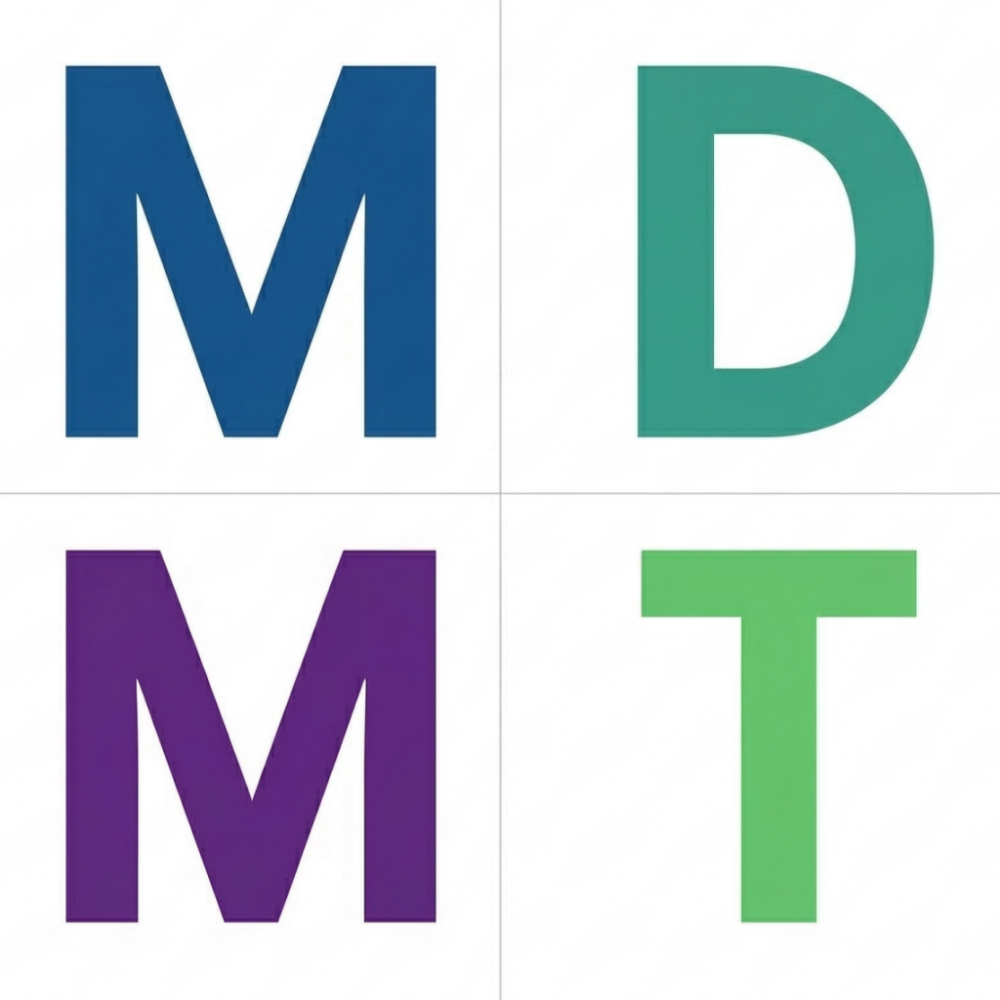
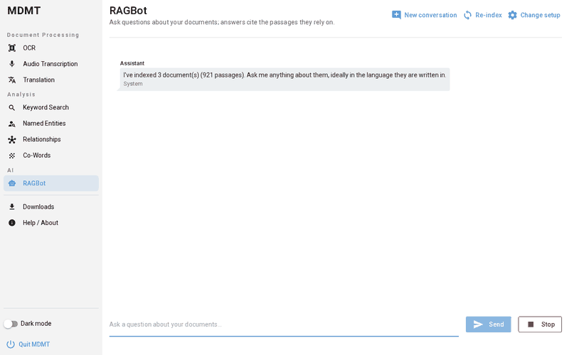
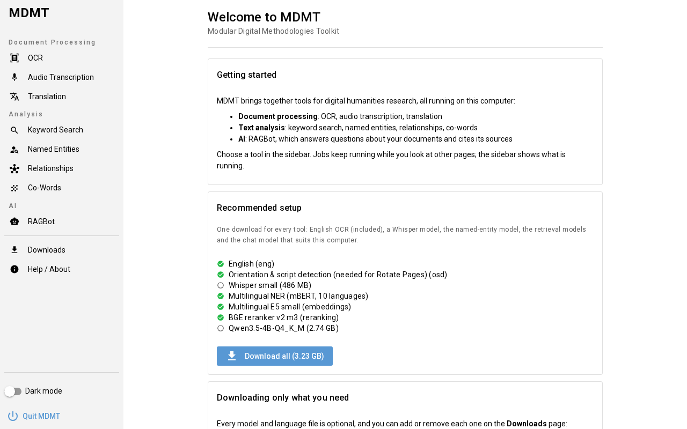

<p align="center"></p>

# Modular Digital Methodologies Toolkit (MDMT)

A comprehensive suite of digital humanities and research tools designed to streamline text analysis, document processing, and data extraction workflows.

## Overview

MDMT is a desktop application that provides researchers, scholars, and digital humanists with a variety of specialized tools for working with text-based documents. It offers a modular approach, allowing users to perform tasks ranging from optical character recognition to language translation and advanced text analysis, all through a unified web-based interface running in a native window (Windows, macOS) or your browser (Linux).

## Features

### Document Processing
- **OCR (Optical Character Recognition)**: Convert image-based PDFs to searchable, selectable text using Tesseract OCR with support for 100+ languages (PDF/A output additionally needs [Ghostscript](https://ghostscript.com/releases/gsdnld.html), which MDMT does not bundle)
- **Audio Transcription**: Convert speech in audio files to text offline with OpenAI's Whisper models, run by faster-whisper (CTranslate2)
- **Language Translation**: Translate documents offline between about 50 languages and English (other pairs via English) with Argos Translate models on CTranslate2; documents never leave your computer. The models are third-party and their licenses vary (59 of 100 state CC BY 4.0, 35 name only their training data, 6 state none): check a model's README, which the Downloads page opens for you, before using its output in published or commercial work.

### Text Analysis
- **Keyword Search**: Find and analyze keyword patterns across document collections with visualization
- **Named Entity Recognition**: Identify and extract people, organizations, locations, and other named entities
- **Relationship Extraction**: Discover connections between entities in texts and visualize network graphs
- **Co-Word Analysis**: Generate word co-occurrence networks to reveal conceptual relationships

### AI Integration
- **RAGBot**: Ask questions about a folder of documents and get answers that cite the passages they come from, from a local Qwen 3.5 model. Retrieval combines keyword search with multilingual embeddings and an optional reranker. MDMT recommends Qwen 3.5 4B on Apple Silicon Macs, where it runs on the GPU, and 2B elsewhere: the Windows and Linux builds run chat models on the CPU.

<p align="center"></p>

## Platform support

| Platform | Prebuilt app | Notes |
|---|---|---|
| Windows 10/11, x64 | `mdmt-windows-x64.zip` | |
| macOS 15 (Sequoia) or newer, Apple Silicon | `mdmt-macos-arm64.zip` | No Intel Mac build. |
| Linux, x86-64 | `mdmt-linux-x86_64.tar.gz` | Built on Ubuntu 24.04; needs a similarly recent distribution. |

Every release build is exercised in CI on its own operating system by `mdmt --self-test`, which runs OCR, transcription, llama.cpp and plotting through the frozen app and checks that the bundled binaries and libraries, not the build machine's, are the ones in use. It runs twice: on the build, and on the release archive after unpacking it as a user would. You can run `mdmt --self-test` yourself; it also reports a download that was extracted without its symbolic links. Note that it downloads about 460 MB of models into MDMT's data folder if they are not there yet (Whisper tiny, the NER model, French→English translation and the retrieval model), the same ones the tools would download on first use. The native window and file dialogs are not covered by CI.

## Installing the prebuilt apps

Download the archive for your platform from the [releases page](https://github.com/James-C-000/Modular-Digital-Methodologies-Toolkit/releases) and extract it (on Linux with your archive manager or `tar -xzf mdmt-linux-x86_64.tar.gz`).

The apps are **not code-signed or notarized**: MDMT is an independent open-source project without paid signing certificates. The source code and the CI logs that built each release are public. Your operating system will ask you to confirm the first launch:

- **macOS:** open `MDMT.app` once and dismiss the warning, then go to **System Settings → Privacy & Security**, click **Open Anyway** next to the message about MDMT (available for about an hour after the attempt), and confirm with your password. Since macOS 15, Control-click → Open no longer bypasses this check. Alternatively, run `xattr -dr com.apple.quarantine /path/to/MDMT.app` in Terminal.
- **Windows:** if SmartScreen shows "Windows protected your PC", click **More info → Run anyway**, then run `mdmt.exe` from the extracted folder.
- **Linux:** run `mdmt/mdmt` from the extracted folder. MDMT opens in your web browser (on Linux it runs as a private local web app rather than in its own window); use **Quit MDMT** in the sidebar to stop it. To add it to your application menu, run `./install-desktop-entry.sh` in the extracted folder.

On Linux, MDMT only listens on 127.0.0.1 and every launch uses a fresh random access token, so other users and web pages cannot reach it. Starting MDMT again while it is running opens a new tab on the existing instance.

Logs are written to the MDMT app data folder (Help / About → **Open log folder**).

## Running from source

### Prerequisites
- Python 3.12 or newer
- Tesseract OCR (system package)
- Optional: Ghostscript, for PDF/A output

### Setup
1. Clone this repository
2. Create a virtual environment and install dependencies:
   ```
   python -m venv .venv
   source .venv/bin/activate
   pip install -r requirements.txt
   ```
   `requirements.txt` uses version ranges for convenience. The exact versions used for releases are in `requirements/lock-<os>.txt` (Python 3.12), regenerated by `requirements/compile.sh`.
3. Run the application:
   ```
   python app.py
   ```

### Tests
```
pytest
python app.py --self-test --self-test-out report.json
```

## Usage

Launch MDMT with `python app.py`. The application opens in a native desktop window on Windows and macOS, and in your web browser on Linux, with a sidebar for navigation between tools. Every tool remembers its settings, and work keeps running in the background while you look at other pages: the sidebar lists running jobs, and a job shows its progress, can be cancelled between files, and ends with a summary, the generated charts or graphs, and a button that opens the output folder.

<p align="center"></p>

1. **OCR**: Process PDFs to make them searchable with text selection
2. **Audio Transcription**: Convert audio files to text transcriptions
3. **Translation**: Translate documents between languages
4. **Keyword Search**: Find and analyze keywords with context
5. **Named Entities**: Extract named entities from documents
6. **Relationships**: Identify entity relationships and generate network graphs
7. **Co-Words**: Generate word co-occurrence networks
8. **RAGBot**: Query your document collection using a local LLM
9. **Downloads**: Download or delete optional assets (Tesseract languages, Whisper models, translation models, the NER model, the retrieval models, Qwen chat models), with progress and the disk space each section uses

Models and language files are never bundled; they are downloaded on demand from the Downloads page, or all at once with the **Recommended setup** on the Welcome page.

A dark mode toggle is available in the sidebar.

## Dependencies

Major dependencies include:
- `nicegui` + `pywebview`: Web-based UI in a native desktop window
- `ocrmypdf`: OCR functionality
- `faster-whisper` (CTranslate2 + PyAV): Audio transcription
- `ctranslate2` + `sentencepiece`/`sacremoses`: offline translation of Argos Translate models; `py3langid`: language detection
- `onnxruntime` + `tokenizers`: named entity recognition (multilingual BERT) and RAG retrieval (multilingual-e5-small embeddings, BM25, optional bge-reranker-v2-m3), all on ONNX; MDMT does not use PyTorch
- `networkx`: graph analysis
- `llama-cpp-python`: local LLM inference for RAG chat (Qwen 3.5 GGUF models)
- `matplotlib`: Data visualization
- `pypdfium2`: PDF text extraction

See `requirements.txt` for a complete list, and the Help/About page for license details on each dependency.

## Building

Platform-specific PyInstaller spec files are provided, each bundling Tesseract OCR and its dependencies (shared settings live in `packaging/spec_common.py`):

```
pip install -r requirements/lock-<os>.txt -r requirements/dev-<os>.txt
CMAKE_ARGS="-DGGML_NATIVE=OFF" pip install --no-deps --no-cache-dir -r requirements/llama.txt
#   on Windows: CMAKE_ARGS="-DGGML_NATIVE=OFF -DGGML_OPENMP=OFF"
pyinstaller mdmt-linux.spec    # Linux   -> dist/mdmt/
pyinstaller mdmt-macos.spec    # macOS   -> dist/MDMT.app
pyinstaller mdmt-windows.spec  # Windows -> dist/mdmt/
```

llama-cpp-python is always compiled from source. `GGML_NATIVE=OFF` targets a baseline CPU instead of the build machine's, so the bundle runs on older CPUs; on Windows, `GGML_OPENMP=OFF` avoids a dependency on MSVC's OpenMP runtime (`vcomp140.dll`), which PyInstaller does not bundle. `--no-cache-dir` matters because pip's wheel cache ignores `CMAKE_ARGS` and would reuse an earlier build made with other flags (for example by `pip install -r requirements.txt`).

Release builds also replace PyPI's PyAV wheel, whose bundled FFmpeg is linked with the GPL encoders libx264/libx265, with PyAV compiled against a decoder-only FFmpeg built from source with no GPL components (`packaging/build_ffmpeg_lgpl.sh`, see `build.yml`). A plain `pip install` is fine for development.

All specs use `--onedir` mode to avoid multi-GB extraction on each launch. `packaging/check_bundle_libs.py` verifies that no bundled binary depends on a library outside the bundle.

Automated cross-platform builds are handled by GitHub Actions (`.github/workflows/build.yml`): each platform is built, checked and self-tested on its own runner, and a release is created when a version tag is pushed. `tests.yml` runs the test suite on all three platforms for every push.

## License

MDMT is licensed under the MIT License — see [`LICENSE`](LICENSE).

The distributed apps contain no GPL code: FFmpeg is built LGPL-only for releases, and Ghostscript (AGPL) is never bundled.

This project uses several open-source libraries, each with their own licenses. The full text of each bundled library's license is in [`THIRD_PARTY_LICENSES`](THIRD_PARTY_LICENSES). See the Help/About page within the application for a per-library attribution table with license types and project links.

## Contact

Software by James C. Caldwell
Email: James.Caldwell.000@gmail.com
GitHub: [James-C-000/Modular-Digital-Methodologies-Toolkit](https://github.com/James-C-000/Modular-Digital-Methodologies-Toolkit)
